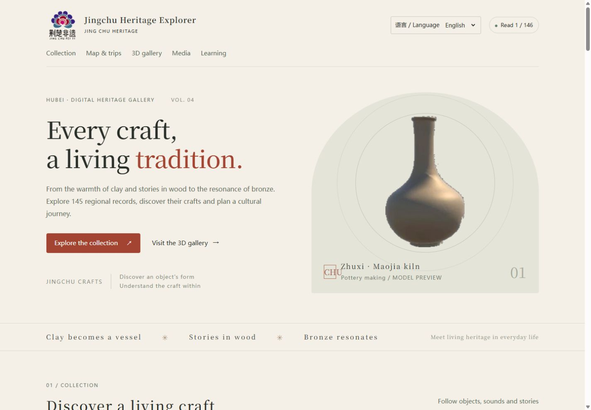
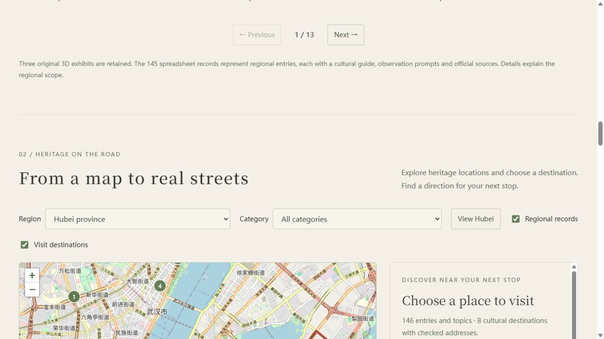

<p align="center"></p>

# Jingchu Heritage Explorer

**[简体中文](README.md) | [English](README.en.md)**

A browser-based exploration of the intangible cultural heritage of Hubei, China, connecting cultural records, street maps, cultural trips and learning activities. It continues an earlier Unity team project through a personal web redevelopment.

**Version 0.5.0 · Vanilla JavaScript / Python · No Unity installation required · No npm build step**

[Project overview](docs/PROJECT_OVERVIEW.md#english) · [Publish on GitHub](docs/GITHUB_PUBLISH.en.md) · [中文发布教程](docs/GITHUB_PUBLISH.zh-CN.md) · [Architecture (Chinese)](docs/ARCHITECTURE.md) · [Validation (Chinese)](docs/VALIDATION.md)

> The public Pages demo and the local resource edition have different scopes. The public demo includes the catalogue, map, road routes, learning tools and local video preview. The original Unity build and archived video are not included. The web application supports Chinese and English, including English cultural guides and observation prompts for all 146 entries, search, trips and quizzes. Original organisation records, external source pages and internal Unity text retain their original language.



*Representative interface; the original model previews come from the earlier team project.*

## Explore the project

- **Switch Chinese and English:** the language is remembered, with English guides and prompts for all 146 records, search, map/trip controls and quizzes. Existing records survive a switch.
- **Read about heritage:** 146 regional entries and topics across ten categories, with combined search/filtering, favourites, pagination, reading records, observation prompts and direct source links.
- **Find places on a street map:** separate layers for 73 regional reference locations and eight public cultural destinations with checked addresses.
- **Plan a cultural trip:** up to eight stops, a chosen starting point, manual ordering, an ordering suggestion, saved itineraries and printing. On request, OSRM provides road geometry, distance, estimated travel time and turn instructions, with Amap navigation links.
- **Learn as you explore:** three- and ten-question quizzes, explanations, attempt history and a personal best score. Reading, favourites and trips stay in the current browser.
- **Connect the legacy 3D experience:** an optional local Unity export contains pottery, wood carving, chimes and a theatre scene. A browser adapter enables left-button camera dragging in the theatre, with a separate interaction mode.
- **Preview video locally:** open your own video without uploading it, and change playback speed. The archived project video requires the separate local resources.

**Counting and location scope:** 145 spreadsheet regional records plus the original pottery topic make 146 entries, not 146 distinct heritage traditions. All 145 records have original short summaries, observation prompts and official source links. The 73 source-coordinate groups have an unspecified coordinate system and are regional references, not navigation entrances. The eight visit destinations use separately checked WGS84 locations.



*An example road result from a test session. Times exclude live traffic and visits. The ordering suggestion uses straight-line nearest neighbours and does not guarantee an optimal driving route.*

## Public demo and local edition

| Edition | Included | Legacy 3D and archived video |
| --- | --- | --- |
| Public GitHub Pages demo | Catalogue, map, routes, learning, local video preview and bilingual introduction | Excluded and clearly labelled |
| Local resource edition | The above plus legacy Unity integration | Requires a separately supplied WebGL export |

### Run locally

Use Python 3.10+ and a modern browser. Unity, Node and npm dependencies are not required to run the application:

```sh
python scripts/serve.py --open
```

Open **http://127.0.0.1:8767/**. On Windows, you can also double-click `启动展馆.cmd`. Keep the terminal open and press Ctrl+C to stop. Opening the HTML file directly does not support module loading.

The optional legacy export can sit alongside the repository:

```text
workspace/
├─ heritage-explorer/       # this repository
└─ WebGL/                  # optional, excluded from the repository
   ├─ Build/
   │  ├─ WebGL.loader.js
   │  ├─ WebGL.framework.js.unityweb
   │  ├─ WebGL.wasm.unityweb
   │  └─ WebGL.data.unityweb
   └─ StreamingAssets/
```

```sh
python scripts/serve.py --runtime-dir "/path/to/WebGL" --port 8768 --open
```

In the theatre, keep “左键环视” (left-button camera look) checked and hold the left mouse button while dragging. Use WASD/arrow keys to move, Space to jump and Shift to sprint. Uncheck camera look before clicking legacy scene buttons. This adapter changes browser input, not the original Unity build. The camera remains third person.

### Publish the web demo

The repository includes `.github/workflows/pages.yml`. Upload the directory containing this README as the repository root. Select **Settings → Pages → Source: GitHub Actions**, then run the workflow. Tests run before the public static site is generated and deployed. Follow the [English deployment guide](docs/GITHUB_PUBLISH.en.md) for the complete steps.

## Implementation

The application uses native ES modules, Leaflet 1.9.4 and OpenStreetMap tiles. A Python standard-library server mounts the optional legacy resources read-only and exposes a destination-restricted OSRM routing adapter. On static hosting, routing falls back to a direct browser request. There are no accounts, cloud synchronisation, forums or multi-user rankings.

```text
.github/workflows/pages.yml  Tests and Pages deployment
 dist/                      Buildless site; about.html is the bilingual introduction
 docs/                      Sources, architecture, guides and screenshots
 scripts/serve.py            Local HTTP, gzip/Wasm/Range and read-only runtime mount
 scripts/routing.py          Destination allowlist, cache and routing adapter
 scripts/package_release.py  Versioned local/public packages
 scripts/check_release.py    Manifest, reference and public-profile checks
 tests/                     JavaScript and Python tests
```

Excel and openpyxl are not runtime requirements. Re-importing the original workbook through `scripts/build_catalog.py` requires openpyxl and that workbook.

## Tests and packages

Node 18+ is needed only for tests. The GitHub workflow selects Node 24 and Python 3.12.

```sh
npm test
python -m unittest discover -s tests -p "test_*.py"
python scripts/package_release.py --public --output output/github-pages
python scripts/check_release.py output/github-pages
python scripts/package_source.py
```

Packaging refuses to overwrite existing outputs. The public profile excludes the legacy build and archived video while retaining local video preview and source attribution.

## Origins and redevelopment

The original Unity scenes, historical interactions and floral identity belong to the earlier team project. This personal continuation adds the standalone web experience, researched content, mapping and road routes, learning records, left-button compatibility, tests, documentation and release workflow. It preserves the distinction between team work and subsequent individual redevelopment. The [bilingual overview](docs/PROJECT_OVERVIEW.md) includes a portfolio-ready description with this attribution intact.

## Current scope and reuse

The legacy export was produced by Unity 2021.3.11f1c2; a complete editable project has not been restored. Chime freezes and theatre physics errors remain known limitations. First/third-person switching is not implemented, and VR headset support has not been verified. The approximately 348 MiB 3D core and 324 MiB archived video are excluded from the source repository. The legacy Unity interface itself is not translated.

OSM tiles and OSRM routing depend on online public services and do not guarantee availability or live traffic. Locations and access points are not guarantees of current open entrances. The app does not request device geolocation. Records stay in the browser; a road request sends only the selected public destination coordinates. Local videos are not uploaded.

No single open-source licence has been selected for this repository. Team branding, legacy model previews, cultural content, map data and third-party libraries retain their respective attribution and permissions. Public availability does not grant a blanket commercial-use licence. See [licensing scope](LICENSE_SCOPE.md), [third-party notices](THIRD_PARTY_NOTICES.md) and [contribution guidance](CONTRIBUTING.md).
