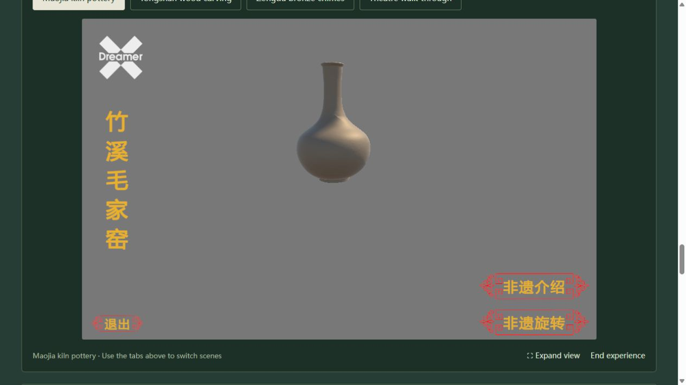

<p align="center"></p>

# 荆楚非遗 · 云上非遗体验馆

**[简体中文](README.md) | [English](README.en.md)** · **1.0.0**

以湖北非物质文化遗产为主题的双语数字展馆，连接文化图鉴、非遗影像、交互地图、文化旅行与三维器物展示。

**[在线体验](https://dangerousdsp.github.io/jingchu-heritage-explorer/)** · [上传与更新指南](docs/GITHUB_PUBLISH.zh-CN.md) · [项目说明](docs/PROJECT_OVERVIEW.md)


## 探索展馆

| 功能 | 内容 |
| --- | --- |
| 双语图鉴 | 146条地区记录与专题，十个门类；组合搜索、收藏、文化导读与来源链接 |
| 非遗影像 | 22张附作者、授权和主题图注的图片；卡片配图、独立图集、放大浏览与专题跳转 |
| 交互地图 | 73组地区参考点与8个文化目的地；点击点位弹出非遗信息，手机可用 |
| 文化旅行 | 多站道路路线、距离与估算用时、行程排序、打印和高德导航 |
| 三维展馆 | 按需加载陶器、木雕、编钟和戏台场景；支持分片资源静态部署 |
| 学习手记 | 阅读记录、三题入门、十题挑战、解析与练习历史 |

地区分布图随网页加载，在线街道图可按需切换。地区参考点用于认识分布，参观目的地用于规划出行。22张图片包含湖北实景、历史器物及标明范围的同类艺术参考。



## 本地运行

需要 Python 3.10+ 和现代浏览器。Windows 可双击 `启动展馆.cmd`，或运行：

```sh
python scripts/serve.py --open
```

也可用普通静态服务器打开 `dist/`。不需要 Unity 或 npm 安装。完整发布包已包含三维资源分片；首次点击三维入口约下载348 MiB，建议电脑和稳定网络。

## 开发与发布

HTML / CSS / 原生 JavaScript · Leaflet · OpenStreetMap · OSRM · Python标准库。

```sh
npm test
python -m unittest discover -s tests -p 'test_*.py'
python scripts/package_release.py --public --auto-webgl --output output/site-1.0.0
python scripts/check_release.py output/site-1.0.0
```

推送到 `main` 后，GitHub Actions 校验并发布 Pages。配置步骤见[中文指南](docs/GITHUB_PUBLISH.zh-CN.md)或[English guide](docs/GITHUB_PUBLISH.en.md)。三维分片必须随源码上传，不使用Git LFS。

花形标志与三维资产来自荆楚非遗团队；网页、资料组织、地图与学习交互在此基础上完善。图片、地图和库的归属见[资源来源](THIRD_PARTY_NOTICES.md)，许可范围见[LICENSE_SCOPE.md](LICENSE_SCOPE.md)。
