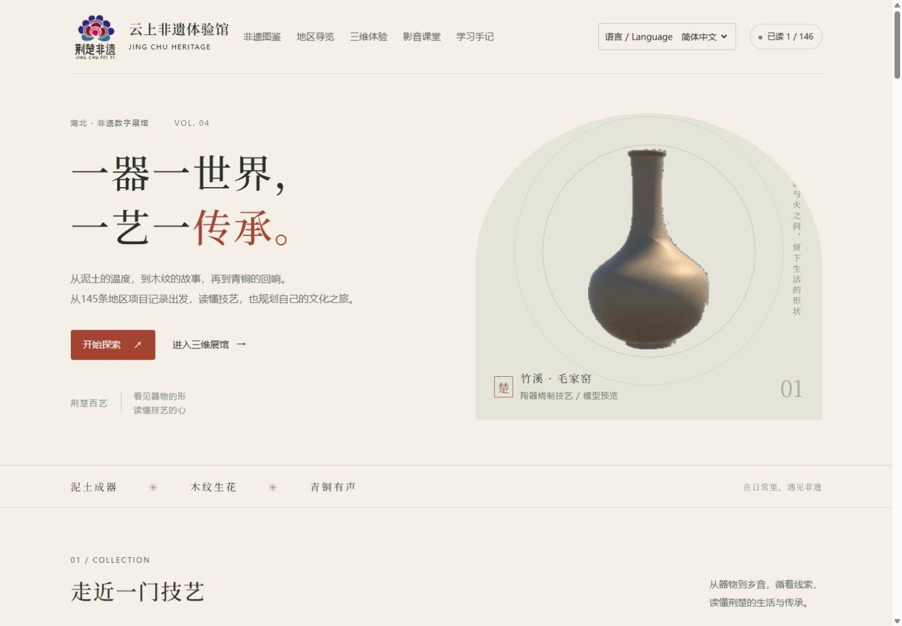
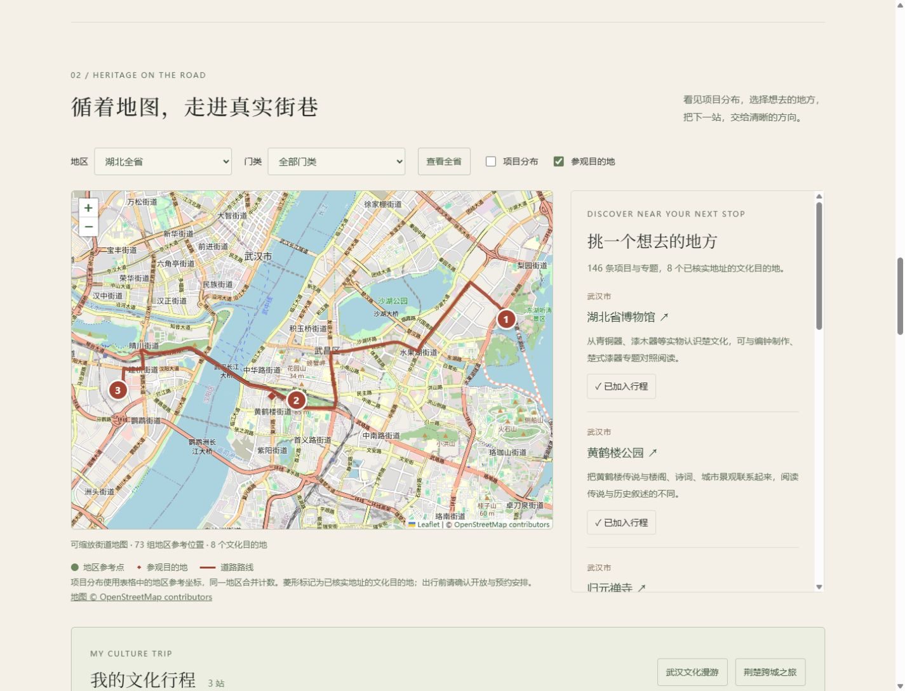

<p align="center"></p>

# 荆楚非遗 · 云上非遗体验馆

**[简体中文](README.md) | [English](README.en.md)**

从一段早期 Unity 团队作品出发，用可独立运行的网页连接湖北非遗资料、真实街道地图、文化行程与互动学习。

**版本 0.5.0 · 原生 JavaScript / Python · 无需安装 Unity · 无需 npm 构建**

[项目介绍](docs/PROJECT_OVERVIEW.md) · [上传与发布教程](docs/GITHUB_PUBLISH.zh-CN.md) · [English deployment guide](docs/GITHUB_PUBLISH.en.md) · [双语范围](docs/LOCALIZATION.md) · [架构](docs/ARCHITECTURE.md) · [验证记录](docs/VALIDATION.md)

> 公开网页演示与本地资源版分开交付。GitHub Pages 演示包含图鉴、地图、道路规划、学习和本地视频预览；源码不包含原 Unity 大型构建及原视频。主网页支持中英文切换，146条文化记录均有英文导读和观察点，英文搜索、地图行程及测验可用。原表机构名称、外部来源正文与旧Unity内部文字保留原文。



*界面示例；截图中的原模型预览来自早期团队项目。*

## 可以做什么

- **中英文切换**：语言选择会记忆；146条英文文化导读、观察点、筛选搜索、地图行程、测验与操作反馈，切换时不清空记录。
- **浏览文化资料**：146条地区项目与专题，覆盖十门类；搜索、地区/类别/收藏组合筛选、12条分页、阅读记录、观察提示和直接来源链接。
- **从地图走向真实地点**：73组地区参考位置与8个经核实地址的公共文化目的地分层展示，支持缩放、选点和图鉴联动。
- **规划文化行程**：最多8站，指定出发点、调整顺序、顺路建议、保存、打印；按需生成OSRM道路路径、距离、估算用时及逐段方向，可跳转高德导航。
- **边看边学**：三题入门与十题挑战、答案解析、成绩历史、个人最佳正确率；阅读、收藏和行程保存在浏览器。
- **继续体验旧三维作品**：单独配置本地资源后，可进入陶器、木雕、编钟及戏台；戏台支持网页左键环视适配和点击交互模式。
- **观看本地影像**：支持用户自己的视频本地预览和播放速度控制；原存档视频需要单独配置资源。

**数量口径**：145条表格地区子项加原陶器专题，共146条，不代表146种互不重复的非遗。145条均附原创简明介绍、观察点和官方来源。73组坐标的原坐标系未注明，只作地区参考；8个参观目的地使用独立核实的WGS84位置。



*道路示例来自一次测试返回值，不含实时交通与停留时间。顺路建议使用直线距离近邻，不保证数学最优。*

## 两种运行方式

| 版本 | 可用功能 | 三维及原视频 |
| --- | --- | --- |
| GitHub Pages公开演示 | 图鉴、地图、道路、学习、本地视频预览、双语介绍 | 未包含；界面明确提示 |
| 本地资源版 | 上述功能及原Unity入口 | 需自行提供保留的WebGL导出 |

### 本地启动

需要Python 3.10+与现代浏览器。无需Unity、Node或npm依赖即可运行网页：

```sh
python scripts/serve.py --open
```

访问 **http://127.0.0.1:8767/**。Windows也可双击 `启动展馆.cmd`。保留终端，结束时Ctrl+C；直接双击HTML不支持模块加载。

原Unity资源是可选项。保留如下目录，或通过参数指定路径：

```text
workspace/
├─ heritage-explorer/       # 本仓库
└─ WebGL/                  # 可选原导出，不上传本仓库
   ├─ Build/
   │  ├─ WebGL.loader.js
   │  ├─ WebGL.framework.js.unityweb
   │  ├─ WebGL.wasm.unityweb
   │  └─ WebGL.data.unityweb
   └─ StreamingAssets/
```

```powershell
python scripts/serve.py --runtime-dir "D:\Archive\WebGL" --port 8768 --open
```

戏台默认勾选“左键环视”：按住左键拖动转向，WASD/方向键移动，空格跳跃，Shift加速。点击场景内按钮前取消勾选。网页将左键映射至旧相机输入，未修改原Unity构建；仍为第三人称。

### 发布到 GitHub Pages

仓库已包含 `.github/workflows/pages.yml`。将**本文件所在目录**作为仓库根目录上传；在GitHub中设置 **Settings → Pages → Source: GitHub Actions**，再运行该工作流。它先测试，再生成公开版并发布。具体步骤和首次部署常见问题见[中文教程](docs/GITHUB_PUBLISH.zh-CN.md)。

## 实现与目录

原生ES模块承担目录、记录、题库和路线交互；Leaflet 1.9.4加载OSM底图。Python标准库服务只读挂载可选Unity导出，并提供受限的OSRM道路适配器。Pages没有Python后端，道路请求使用浏览器跨域回退。没有账户、云端同步、论坛或多用户排名。

```text
.github/workflows/pages.yml  测试与Pages部署
 dist/                      无需打包的网页；about.html为双语项目介绍
 docs/                      架构、来源、说明、教程及截图
 scripts/serve.py            本地HTTP、gzip/Wasm/Range与只读资源挂载
 scripts/routing.py          目的地白名单、缓存与道路接口
 scripts/package_release.py  版本化本地/公开版打包
 scripts/check_release.py    清单、引用与公开版边界校验
 tests/                     JavaScript与Python测试
 README.en.md               English project documentation
```

运行时不需要Excel或openpyxl；只有重新导入工作表的 `scripts/build_catalog.py` 需要openpyxl与原始工作簿。

## 检查与打包

Node 18+仅用于自动测试；GitHub工作流使用Node 24与Python 3.12。

```sh
npm test
python -m unittest discover -s tests -p "test_*.py"
python scripts/package_release.py --public --output output/github-pages
python scripts/check_release.py output/github-pages
python scripts/package_source.py
```

输出路径已存在时打包会停止，避免覆盖历史版本。公开版省略三维/原视频，并保留本地预览和来源署名。

## 项目来路与后续贡献

原Unity三维、历史交互和花形标志源自早期团队项目。这一版是基于遗留作品的个人后续重构，新增独立网页结构、资料整理、地图与道路规划、学习记录、左键输入兼容、测试、文档及发布流程。**原团队作品与后续个人工作均保留归属说明**，不把团队资源描述成独立创作。详细项目介绍含可用于作品集的中英文表述。

## 当前边界与资料使用

原Unity导出来自2021.3.11f1c2，可编辑完整工程尚未恢复；已知编钟卡顿、戏台物理错误仍在。未实现第一/第三人称切换，未验证真实VR头显。原三维核心约348MiB、原视频约324MiB，均不进入源码仓库。网页已支持双语；原Unity内部界面未翻译。

OSM底图及OSRM道路依赖在线公共服务，不保证可用性或实时路况。场馆位置和接驳不等于当前开放入口，出行前需核对官方安排。应用不获取设备定位；记录保存在浏览器，主动请求道路时仅发送选定公共目的地坐标。本地视频不会上传。

本仓库未选定统一开源许可证。团队标志、历史模型预览、文化资料、地图数据与第三方库分别保留来源及原许可；不能因仓库公开就认定全部资源可自由商用。见[许可范围](LICENSE_SCOPE.md)、[第三方来源](THIRD_PARTY_NOTICES.md)和[贡献说明](CONTRIBUTING.md)。
